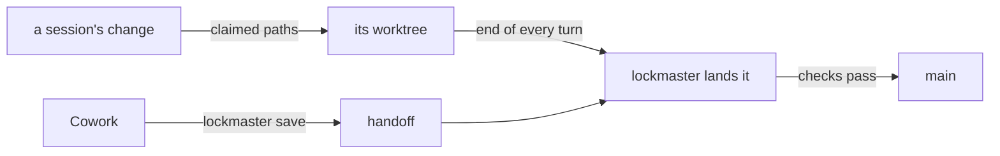

# SR-WORK-LANDING — a change reaches main only through lockmaster

## §1 — For humans

**`main` moves only through lockmaster.** A session claims the paths it will
change, works in its own worktree, and lockmaster lands the change after the
checks in `lockmaster.toml` — one change at a time, as a plain git commit. A
surface that cannot commit (the Cowork bridge) hands its edits to the next
Claude Code session with `lockmaster save`. How it works is lockmaster's, not
this repository's: its specification is SR-ARCHITECTURE, in the lockmaster
repository.



<details>
<summary><b>ASCII twin</b></summary>

```text
   a session's change --claimed paths--> its worktree --end of every turn--> lockmaster lands it
   Cowork --lockmaster save--> handoff --> lockmaster lands it
   lockmaster lands it --checks pass--> main
```

</details>

---

## §2 — For agents

### Context

Several sessions — Claude Code and Cowork, often at once — change this
repository. Commits made straight to `main` by each of them collide, and work
is lost or landed half-checked. lockmaster serialises the landings.

### Decision

1. **No agent session commits or pushes to `main`.** The kit's `block-main.py`
   refuses it.
2. **Work is a change:** `lockmaster start <item> --paths <path> …` claims the
   paths and makes a worktree; `claim-guard.py` warns on a write outside the
   claim; `lockmaster submit -m "<item>: …"` lands it and removes the worktree.
3. **Nothing waits for `submit`:** the kit's `auto-land.py` lands what a change
   holds at the end of every turn, and lands what Cowork handed over.
4. **From Cowork, never commit:** `lockmaster save -m "<item>: …" <path> …`
   lands the edits or hands them off. The `landing` skill
   (`.claude/skills/landing/`) has the rest.
5. **The four hooks this record owns are lockmaster's kit.** They are changed
   in the lockmaster repository's `kit/` and reinstalled with
   `lockmaster install .`; an edit made here is reported by `lockmaster doctor`
   and overwritten by the next install. `work-files.py` reminds a session, once
   at `Stop`, that it changed files but no work file (lockmaster's law L10).

### Consequences

- This record changes when lockmaster's landing contract changes, never because
  a hook's code moved: the code's specification lives in lockmaster.
- What a landing checks is this repository's own, in `lockmaster.toml`.

### Alternatives considered

- Restating lockmaster's architecture here — rejected under L0: one home per
  rule, and that home is in the lockmaster repository.

### Reference (required)

- `.claude/lockmaster.lock` — the kit version these hooks were installed from.
- `lockmaster.toml` — this repository's checks and merge drivers.

### Veto condition

**Reopen this decision if:** `main` carries a commit no lockmaster landing
made, or a kit hook differs from the version pinned in `.claude/lockmaster.lock`.

**How to check it:** `lockmaster doctor` reports no changed kit file, and
`lockmaster queue` accounts for every recent landing.

---

## References

**Records** — [SR-LAW-0](0002_LAW-0-authority.md) · [SR-WORK-SESSION](0054_WORK-session.md) · [SR-WORK-OWNERSHIP](0058_WORK-ownership.md)

**Code** — `.claude/hooks/claim-guard.py` · `.claude/hooks/block-main.py` · `.claude/hooks/auto-land.py` · `.claude/hooks/work-files.py`
