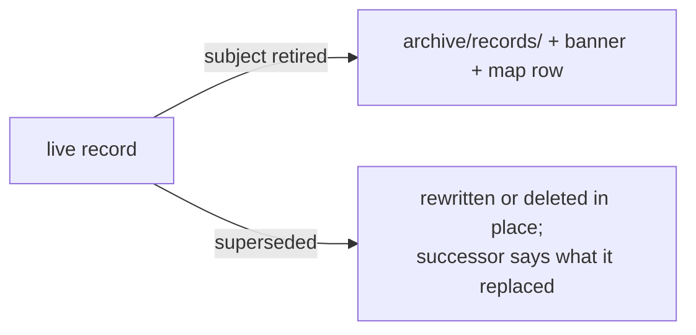

# SR-LAW-1 — L1, a retired record is archived, never deleted

## §1 — For humans

**A retired record is moved, never deleted.** When the subject, rule or law it
states is retired, the file goes to `archive/records/` in the same change —
`status: archived`, a top banner `ARCHIVED <date> — retired by <ruling>`, and a
row in `archive/README.md`.

**Superseded is not retired.** A record replaced by a newer decision on the same
subject is rewritten or deleted in that change, and its successor says in prose
what it replaced. Only a subject that stops existing is archived.

**An archived record may be named, never cited** as grounding for a live claim.



<details>
<summary><b>ASCII twin</b> — the same diagram, for terminals and diffs</summary>

```text
   live record --subject retired--> archive/records/ + banner + map row
        |
        +-------superseded--------> rewritten or deleted in place
                                     (successor says what it replaced)
```

</details>

---

## §2 — For agents

### Context

Deleting a retired record loses the reasoning a later session needs when the
question comes back; leaving it in `records/` lets a session cite a rule nobody
holds.

### Decision

1. When a record's subject, rule or law is retired, the record is **moved** to
   `archive/records/`, mirroring its path, **in the same change** — with a row
   in `archive/README.md`, `status: archived`, and a top banner
   `ARCHIVED <date> — retired by <ruling>`.
2. An archived record may be **named, never cited** as grounding for a live
   claim.
3. A **superseded** record is different: it is rewritten or deleted in the
   change that supersedes it, and the successor says in prose what it replaced.
4. A retired law is written `ex-L<n>` in live text; its handle is never reused.

### Consequences

- Nothing mechanical checks the move, the banner or the map row; it is judgment
  until a test exists.
- A retired law's handle is spent for good (`ex-Ln`), so the SR-LAWS table only
  grows.

### Alternatives considered

- Delete retired records and rely on git history — rejected: a cold session
  does not read history, and the map row is what points at the successor.
- Keep retired records in `records/` marked retired — rejected: a live
  directory holding dead rules invites citing them.

### Reference (required)

- [`archive/README.md`](../archive/README.md) §`records/` — the map every
  retired record gets a row in.
- [SR-WORK-ARCHIVE](0057_WORK-archive.md) — what an archived document may and
  may not do.

### Veto condition

**Reopen this decision if:** `archive/records/` holds a file without an `archive/README.md` row, or `records/` holds a `status: archived` file.

**How to check it:** `ls archive/records/` against the `records/` table in `archive/README.md`, and `grep -l '^status: archived' records/*.md` must print nothing.

---

## References

*Every source this record cites, gathered in one place. An archived document is never listed here.*

**Records** — [SR-LAW-0](0002_LAW-0-authority.md) · [SR-LAWS](0001_LAWS.md) · [SR-WORK-ARCHIVE](0057_WORK-archive.md)

**Project docs**

- [`archive/README.md`](../archive/README.md)
