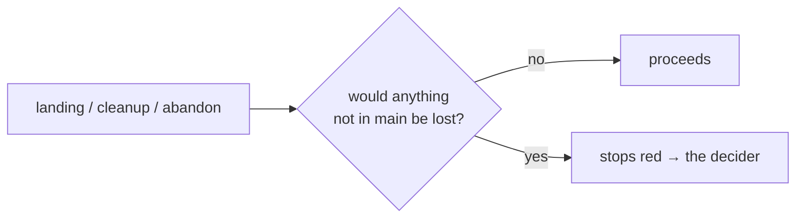

# SR-LAW-3 — L3 — never lose work

## §1 — For humans

**The law (L3).**

> **lockmaster never loses work.** No landing, cleanup or `abandon` discards a commit, an uncommitted file or a branch whose work is not already in `main`. lockmaster never runs `--force`, `branch -D`, `reset --hard`, `git clean`, `worktree remove --force` or a force push. Anything that would lose data **stops red** and goes to the decider; it is never resolved by deleting.

**Ruled by Arpit, 2026-10-25,** on [W-01](../archive/open/W-01-rule-the-laws.md): *"All the blockers, I accept whatever is said over there."*

**Why it exists.** It is the product's whole promise: agents hand lockmaster their work, so a tool that can drop it is worse than none. The same rule already governs cleanup ([SR-WORK-CLEANUP](0062_WORK-cleanup.md), ruled 2026-10-24); this makes it bind the tool itself.



<details>
<summary><b>ASCII twin</b></summary>

```text
   landing / cleanup / abandon --> would anything not in main be lost?
                                      no:  proceeds
                                      yes: stops red -> the decider
```

</details>

---

## §2 — For agents

### Context

A lander touches every change on its way to `main`, and cleanup removes worktrees and branches. Each is one wrong flag away from deleting someone's work.

### Decision

1. **What counts as work:** a commit not reachable from `main`, an uncommitted or untracked file in a change's worktree, and a branch whose commits are not all in `main`.
2. **Removal only after proof.** A worktree or branch is removed only once git itself shows nothing on it is missing from `main` (the safe forms: `git worktree remove` without `--force`, `git branch -d`).
3. **The forbidden operations:** `--force` / `-f` on any destructive git command, `branch -D`, `reset --hard`, `git clean`, `checkout --` over changes, `push --force`. Not in `src/`, not in `kit/`, not in a test helper run against a real repository.
4. **Red, not a choice.** When work would be lost, lockmaster stops, keeps everything as it is, and puts a row in the decider's inbox ([SR-WORK-OPEN-QUEUE](0051_WORK-open-queue.md)). Only the decider rules that work may go.

### Consequences

- A law outranks every record ([SR-LAW-0](0002_LAW-0-authority.md)): where [SR-ARCHITECTURE](0101_architecture.md) or a work item disagrees with L3, L3 holds and the other is corrected.

### Alternatives considered

- Leaving it to SR-ARCHITECTURE — rejected: a rule the tool must never break belongs above the design that implements it.

### Reference (required)

- [SR-ARCHITECTURE](0101_architecture.md) — the design this law binds.

### Veto condition

**Reopen this decision if:** a landing, cleanup or `abandon` ever loses a commit or a file, or `src/` or `kit/` holds a forbidden operation.

**How to check it:** `grep -rnE -- "--force|branch -D|reset --hard|git clean|push -f" src kit/claude` prints nothing (CI runs the same grep).

---

## References

**Records** — [SR-LAWS](0001_LAWS.md) · [SR-ARCHITECTURE](0101_architecture.md) · [SR-WORK-CLEANUP](0062_WORK-cleanup.md)
