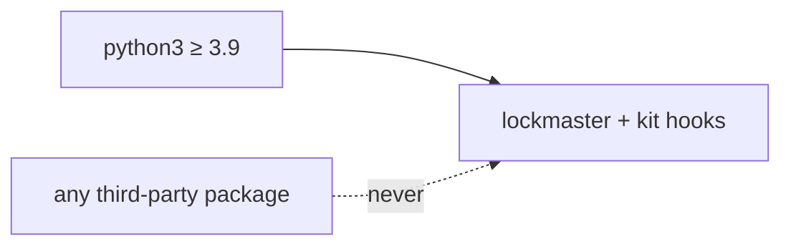

# SR-LAW-4 — L4 — zero runtime dependencies

## §1 — For humans

**The law (L4).**

> **lockmaster has zero runtime dependencies.** The package and every hook in `kit/` run on the Python standard library alone, on Python ≥ 3.9. `pyproject.toml` declares no `dependencies`. Build and release tools (`build`, `twine`) are not runtime and are allowed.

**Ruled by Arpit, 2026-10-25,** on [W-01](../archive/open/W-01-rule-the-laws.md): *"All the blockers, I accept whatever is said over there."*

**Why it exists.** lockmaster installs into every repository and runs inside hooks on every tool call. Nothing to resolve means nothing to break, nothing to audit, and it works on the decider's Mac's `python3` (3.9) as it is.



<details>
<summary><b>ASCII twin</b></summary>

```text
   python3 >= 3.9 --> lockmaster + kit hooks
   third-party package --never--> lockmaster
```

</details>

---

## §2 — For agents

### Context

A dependency in a hook is a dependency in every session of every repository that installs the kit.

### Decision

1. **`pyproject.toml` `dependencies` stays empty.** Optional extras are not allowed either: an extra is a second product.
2. **Python ≥ 3.9.** A standard-library module newer than 3.9 is used only behind a fallback (`tomllib` on ≥ 3.11, lockmaster's own reader below — [SR-ARCHITECTURE](0101_architecture.md)).
3. **What is not runtime:** packaging and release tools, and the test runner (`unittest`, also standard library).

### Consequences

- A law outranks every record ([SR-LAW-0](0002_LAW-0-authority.md)): where [SR-ARCHITECTURE](0101_architecture.md) or a work item disagrees with L4, L4 holds and the other is corrected.

### Alternatives considered

- Leaving it to SR-ARCHITECTURE — rejected: a rule the tool must never break belongs above the design that implements it.

### Reference (required)

- [SR-ARCHITECTURE](0101_architecture.md) — the design this law binds.

### Veto condition

**Reopen this decision if:** `pyproject.toml` declares a dependency, or `src/` or `kit/` imports a module outside the standard library.

**How to check it:** `grep -n '^dependencies' pyproject.toml` shows none or `[]`; `python3 -I -m lockmaster --help` runs in a fresh virtual environment with nothing installed.

---

## References

**Records** — [SR-LAWS](0001_LAWS.md) · [SR-ARCHITECTURE](0101_architecture.md)
