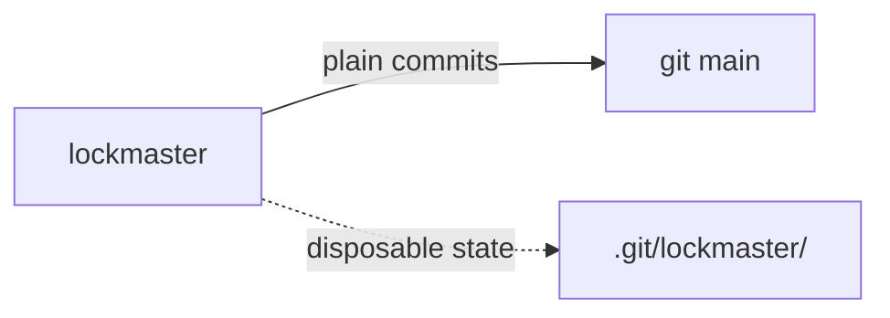

# SR-LAW-5 — L5 — git stays the store

## §1 — For humans

**The law (L5).**

> **git stays the store.** Every change lockmaster lands is an ordinary git commit on `main`, readable with git alone. lockmaster keeps no history of its own: its state (claims, the queue, the land lock) is working state, under git's own directory, and losing it loses no work.

**Ruled by Arpit, 2026-10-25,** on [W-01](../archive/open/W-01-rule-the-laws.md): *"All the blockers, I accept whatever is said over there."*

**Why it exists.** lockmaster can then be uninstalled at any moment and nothing is lost; history, blame and diff stay git's. Anthropic's answer at monorepo scale was a new store; at one laptop the same ideas fit on top of git (`work/compare/source-control.compare.md`).



<details>
<summary><b>ASCII twin</b></summary>

```text
   lockmaster --plain commits--> git main
   lockmaster ..disposable state..> .git/lockmaster/
```

</details>

---

## §2 — For agents

### Context

A tool that keeps its own history becomes a second source of truth the moment it disagrees with git.

### Decision

1. **A landing is a commit** with a `Lockmaster-Change:` trailer and nothing else lockmaster-specific; `git log` reads it.
2. **State is disposable.** `$(git rev-parse --git-common-dir)/lockmaster/` holds claims, the queue and the lock; deleting it loses queue positions, never work (the work is on branches, [SR-LAW-3](0005_LAW-3-never-lose-work.md)).
3. **No server, no database, no format of its own** for anything that must survive.

### Consequences

- A law outranks every record ([SR-LAW-0](0002_LAW-0-authority.md)): where [SR-ARCHITECTURE](0101_architecture.md) or a work item disagrees with L5, L5 holds and the other is corrected.

### Alternatives considered

- Leaving it to SR-ARCHITECTURE — rejected: a rule the tool must never break belongs above the design that implements it.

### Reference (required)

- [SR-ARCHITECTURE](0101_architecture.md) — the design this law binds.

### Veto condition

**Reopen this decision if:** reading the repository's history ever needs lockmaster, or deleting lockmaster's state directory loses work.

**How to check it:** `git log --format='%h %s' main` reads every landing with plain git; removing `.git/lockmaster/` in a scratch repo leaves every branch and commit in place.

---

## References

**Records** — [SR-LAWS](0001_LAWS.md) · [SR-ARCHITECTURE](0101_architecture.md)
