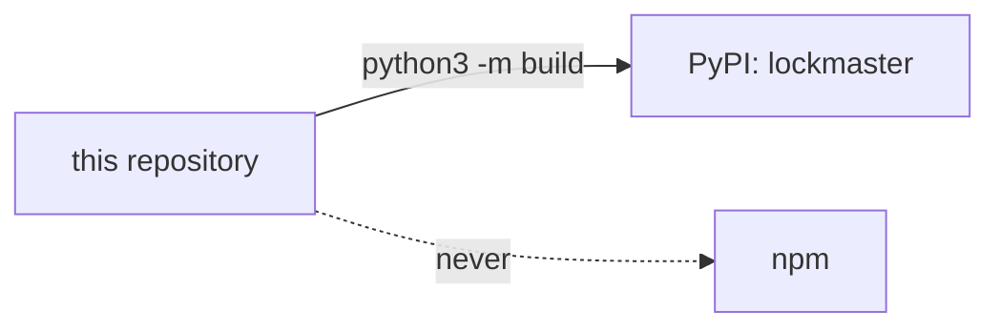

# SR-LAW-6 — L6 — Python only, on PyPI

## §1 — For humans

**The law (L6).**

> **lockmaster is a Python-only project.** It is one Python package, `lockmaster`, published on PyPI and nowhere else. There is no npm package, no npm launcher and no second implementation in another language. A repository of any language uses it through `python3` (`pipx install lockmaster`, or `python3 -m lockmaster`).

**Ruled by Arpit, 2026-10-25,** on [W-01](../archive/open/W-01-rule-the-laws.md): *"All the blockers, I accept whatever is said over there."* — then: *"I want this to be Python only project. I don't believe we need npm."*

**Why it exists.** The decider ruled it: *"I want this to be Python only project. I don't believe we need npm."* One language, one registry, one release: nothing to keep in step. Every repository it serves has `python3` already; the hooks are Python today.



<details>
<summary><b>ASCII twin</b></summary>

```text
   this repository --build--> PyPI: lockmaster
   this repository --never--> npm
```

</details>

---

## §2 — For agents

### Context

W-01 proposed *one tool, two registries* (PyPI and npm). The decider changed it to one.

### Decision

1. **One package, one registry.** `lockmaster` on PyPI is the only distribution. Nothing is published to npm, under any name or scope.
2. **No Node.** No file in `src/` or `kit/` needs Node to run; no `package.json` in this repository.
3. **The npm org `@lockmaster`**, created 2026-10-25 a minute before this ruling, holds nothing and is not used; keeping or deleting it is the decider's ([W-08](../work/open/W-08-hold-the-name.md)).

### Consequences

- A law outranks every record ([SR-LAW-0](0002_LAW-0-authority.md)): where [SR-ARCHITECTURE](0101_architecture.md) or a work item disagrees with L6, L6 holds and the other is corrected.

### Alternatives considered

- **One tool, two registries (PyPI and npm)** — proposed in W-01; changed by the decider to Python only.

### Reference (required)

- [SR-ARCHITECTURE](0101_architecture.md) — the design this law binds.

### Veto condition

**Reopen this decision if:** anything is published from this repository outside PyPI, or a `package.json` appears in it.

**How to check it:** `git ls-files | grep -c package.json` prints 0.

---

## References

**Records** — [SR-LAWS](0001_LAWS.md) · [SR-ARCHITECTURE](0101_architecture.md)
