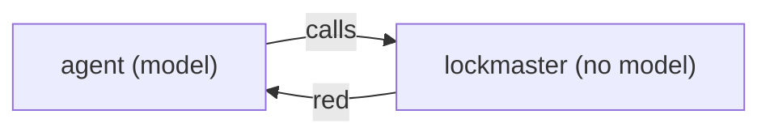

# SR-LAW-7 — L7 — no model in the lander

## §1 — For humans

**The law (L7).**

> **There is no AI model in lockmaster.** The tool never calls a language model or any other model, to land, to merge, to resolve a conflict or to write a message. Agents call lockmaster; lockmaster never calls an agent. A conflict it cannot resolve by its own fixed rules goes red, to the agent and then the decider.

**Ruled by Arpit, 2026-10-25,** on [W-01](../archive/open/W-01-rule-the-laws.md): *"All the blockers, I accept whatever is said over there."*

**Why it exists.** Determinism: the same queue on the same `main` lands the same way every time, and every landing can be explained by reading the code. A model in the lander would make a commit on `main` depend on a sample.



<details>
<summary><b>ASCII twin</b></summary>

```text
   agent (model) --calls--> lockmaster (no model)
   lockmaster --red--> agent
```

</details>

---

## §2 — For agents

### Context

Merging is where a model is most tempting — and where a wrong guess silently ships.

### Decision

1. **No model calls** in `src/`: no API client, no network call to a model provider, no subprocess that starts one.
2. **Fixed rules only:** a structural merge driver either applies its rule or reports a conflict; it never guesses.
3. **The agent fixes, lockmaster re-checks.** A red change goes back to the agent that made it; when it resubmits, lockmaster runs the same deterministic landing again.

### Consequences

- A law outranks every record ([SR-LAW-0](0002_LAW-0-authority.md)): where [SR-ARCHITECTURE](0101_architecture.md) or a work item disagrees with L7, L7 holds and the other is corrected.

### Alternatives considered

- Leaving it to SR-ARCHITECTURE — rejected: a rule the tool must never break belongs above the design that implements it.

### Reference (required)

- [SR-ARCHITECTURE](0101_architecture.md) — the design this law binds.

### Veto condition

**Reopen this decision if:** anything in `src/` calls a model, or a landing's result differs between two runs on the same inputs.

**How to check it:** `grep -rniE 'anthropic|openai|api\.|http' src` prints nothing that reaches a model.

---

## References

**Records** — [SR-LAWS](0001_LAWS.md) · [SR-ARCHITECTURE](0101_architecture.md)
