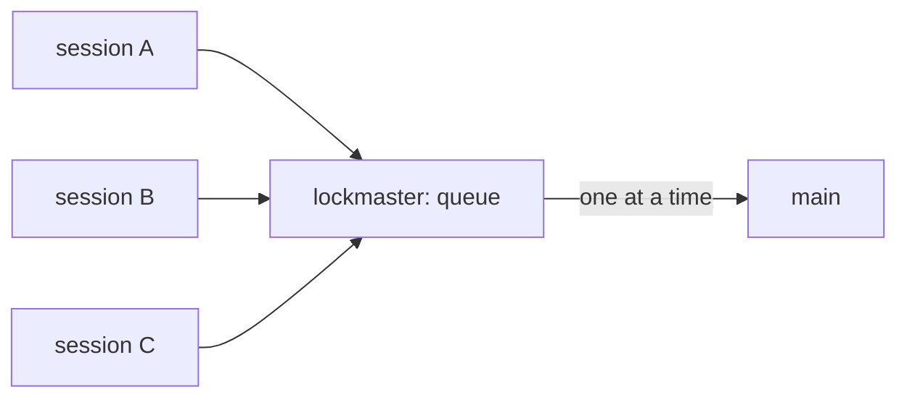

# SR-LAW-8 — L8 — lockmaster handles parallel requests

## §1 — For humans

**The law (L8).**

> **Any number of sessions may call lockmaster at the same moment.** Every request is served or queued — never lost, never refused because another request is running, never left for a person to untangle. Landings stay one at a time; the waiting is lockmaster's, not the caller's.

**Ruled by Arpit, 2026-11-05 (Cowork):** *"lock master should handle parallel requests."*

**Why it exists.** lockmaster exists because many agents work in one repository at once. A lander that only works when callers take turns solves nothing.



<details>
<summary><b>ASCII twin</b></summary>

```text
   session A --\
   session B ----> lockmaster: queue --one at a time--> main
   session C --/
```

</details>

---

## §2 — For agents

### Context

Every-turn landing (SR-ARCHITECTURE decision 20) and Cowork handoffs (decision 19) mean several sessions call `start`, `submit`, `save`, `sync` and `pickup` in the same seconds. Concurrency is the normal case, not the edge case.

### Decision

1. **Any command, any number of callers.** Every `lockmaster` command may run at the same time as any other, from any number of sessions, worktrees and surfaces in one repository.
2. **No request is lost.** A request lockmaster accepted ends landed, held, red with a reason, or still queued — never silently dropped. Two submits at the same instant both land.
3. **No request is refused for being concurrent.** A busy lander means *queued*, not an error: the caller exits successfully and is never told to retry.
4. **State is never torn.** Every write to lockmaster's state is written aside and renamed in; no reader sees half a file. A lock whose holder died is taken over, and the change it left mid-landing is queued again.
5. **Contention on `main` is lockmaster's to resolve.** A change never goes red only because another landing went first; it is redone on the new `main`.
6. **Parallel work never crosses.** One request's edits never land under another's change (only claimed paths land; L3 holds).
7. **Parallel requests, serial landings.** This law does not require two landings at once; one lander at a time stays (SR-ARCHITECTURE decision 7).

### Consequences

- A law outranks every record ([SR-LAW-0](0002_LAW-0-authority.md)): where [SR-ARCHITECTURE](0101_architecture.md) disagrees with L8, L8 holds and the other is corrected.
- **Proven by real concurrent processes** in [`tests/test_parallel.py`](../tests/test_parallel.py) ([W-13](../archive/open/W-13-prove-parallel-requests.md)): sessions that start and submit at once, saves in the same second, handoffs asking for one name, and two end-of-turn landings of one session. The proof found three breaches, now fixed: saves in one second took one name; handoffs written at once overwrote each other; and two end-of-turn landings of one session could commit in one worktree at once. A fourth showed on 2026-11-07, intermittently: `git worktree add` dies when it reads another worktree being added at that moment, so a `start` was refused as "started by another session" and a landing could fail. `git.worktree_add` retries it ([W-10](../archive/open/W-10-dirty-main-checkout.md)).
- A pickup re-reads the handoffs before it lets go, so one written meanwhile is not left for the next session.

### Alternatives considered

- Leaving it to SR-ARCHITECTURE decisions 6–7 — rejected: those describe the mechanism; the guarantee the tool must never break belongs above it.
- Requiring parallel landings — rejected: serial landing is an accepted cost and keeps every landing explainable.

### Reference (required)

- [`src/lockmaster/repo.py`](../src/lockmaster/repo.py) — the land lock and the atomic state write.
- [`tests/test_parallel.py`](../tests/test_parallel.py) — several processes at once.
- [`tests/test_land.py`](../tests/test_land.py) — `test_a_second_lander_waits_its_turn`.

### Veto condition

**Reopen this decision if:** a run that starts several processes calling `submit` and `save` at once ends with a change lost, a torn state file, a change red only because another landed first, or a caller told to retry.

**How to check it:** `cd tests && PYTHONPATH=../src python3 -m unittest test_parallel`

---

## References

**Records** — [SR-LAWS](0001_LAWS.md) · [SR-LAW-0](0002_LAW-0-authority.md) · [SR-LAW-3](0005_LAW-3-never-lose-work.md) · [SR-ARCHITECTURE](0101_architecture.md)

**Code**

- [`src/lockmaster/repo.py`](../src/lockmaster/repo.py)
- [`src/lockmaster/land.py`](../src/lockmaster/land.py)
- [`tests/test_land.py`](../tests/test_land.py)
- [`tests/test_parallel.py`](../tests/test_parallel.py)

**Project docs**

- [`archive/open/W-13-prove-parallel-requests.md`](../archive/open/W-13-prove-parallel-requests.md)
