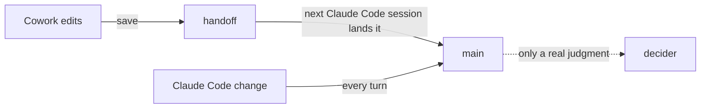

# SR-LAW-9 — L9 — Cowork and Claude Code work in parallel with no manual step

## §1 — For humans

**The law (L9).**

> **A Cowork session and a Claude Code session may work in the same repository at the same time, and every change either one makes reaches `main` with no step by the decider** — no command typed, no session opened just to unstick it, no lock file deleted, no handoff chased. Cowork's edits land when the next Claude Code session starts in that repository, as part of its ordinary work. Only a real judgment reaches the decider: a true conflict or a failed check no agent can fix.

**Ruled by Arpit, 2026-11-05 (Cowork):** *"lock master should handle cowork and claude code in parallel without manual intervention"* — and, asked whether a background job should land handoffs: *"no background job, when ever next time the claude code starts it can go ahead and commit it."*

**Why it exists.** The decider works from both surfaces. If one surface's work waits for him to open the other, the tool has moved the chore, not removed it.



<details>
<summary><b>ASCII twin</b></summary>

```text
   Cowork edits --save--> handoff --next Claude Code session lands it--> main
   Claude Code change --every turn----------------------------> main
   main ..only a real judgment..> decider
```

</details>

---

## §2 — For agents

### Context

The Cowork bridge cannot commit (SR-ARCHITECTURE decision 19), so its edits are handed off and landed by `lockmaster pickup`, which the kit's `auto-land.py` runs at a Claude Code session's start and at the end of each turn. Pickup used to land whatever sat under a handoff's paths at pickup time, so another session's later edit rode in under the handoff's message. And Cowork edits left in `main`'s checkout turned three codelaw landings red ([W-10](../work/open/W-10-dirty-main-checkout.md)).

### Decision

1. **Neither surface waits on the other.** Each works and lands while the other is mid-session; neither asks the decider about commits, locks, worktrees or handoffs.
2. **A handoff lands at the next Claude Code session's start** in that repository — the session's hook runs `pickup`, no model involved (L7). No background job runs it: the decider ruled that the next Claude Code session is soon enough, and opening one for ordinary work is not a manual step. Every pickup that lands nothing it could have is a breach.
3. **What lands is what was handed over.** A handoff records each file's content digest. A file edited in `main`'s checkout after its handoff, and not handed off again, holds the handoff — nothing lands under its message — until that edit is handed off too or undone. Handoffs that name a common file land together, as one change under all their messages, since the file holds the newest edit. A handoff that went red is fixed where it is; edits after that are its fix.
4. **One surface's edits never turn the other's landing red.** A Cowork edit sitting in `main`'s checkout makes a Claude Code landing wait, not fail ([W-10](../work/open/W-10-dirty-main-checkout.md)); the edit itself is never touched.
5. **Which surface can commit is lockmaster's question.** `lockmaster can-commit` decides; the decider is never asked.
6. **Parallel requests from both surfaces are L8's** ([SR-LAW-8](0010_LAW-8-parallel-requests.md)); this law adds that the two surfaces' differences never need a person.

### Consequences

- A law outranks every record ([SR-LAW-0](0002_LAW-0-authority.md)): where [SR-ARCHITECTURE](0101_architecture.md) disagrees with L9, L9 holds and the other is corrected.
- Decisions 2, 3 and 5 are built ([W-14](../work/open/W-14-cowork-and-claude-code-unattended.md)). **Decision 4 is not:** it is met when [W-10](../work/open/W-10-dirty-main-checkout.md) lands.
- Accepted cost: a Cowork-only day lands nothing until a Claude Code session starts.

### Alternatives considered

- A background job (`launchd`) running `pickup` every few minutes — rejected by the decider, 2026-11-05: the next Claude Code session lands it.
- Landing a handoff with whatever sits under its paths at pickup — rejected: another session's unsaved edit would land under the handoff's message.
- Letting the Cowork bridge commit — rejected in SR-ARCHITECTURE decision 19: it sees the Mac's repository at another path, so a prune from it would cut off the Mac's worktrees.

### Reference (required)

- [SR-ARCHITECTURE](0101_architecture.md) decisions 19–20 — the handoff and every-turn landing this law binds.
- [`src/lockmaster/surface.py`](../src/lockmaster/surface.py) — `can-commit`.
- [`tests/test_parallel.py`](../tests/test_parallel.py) — held, joined and missed handoffs.

### Veto condition

**Reopen this decision if:** a handoff survives a pickup with no reason given (`queue` marks it `MISSED`), or a held or red change's reason is the other surface's uncommitted edit.

**How to check it:** `PYTHONPATH=src python3 -m lockmaster queue | grep -E 'MISSED|uncommitted edits there'` prints nothing.

---

## References

**Records** — [SR-LAWS](0001_LAWS.md) · [SR-LAW-0](0002_LAW-0-authority.md) · [SR-LAW-3](0005_LAW-3-never-lose-work.md) · [SR-LAW-7](0009_LAW-7-no-model-in-the-lander.md) · [SR-LAW-8](0010_LAW-8-parallel-requests.md) · [SR-ARCHITECTURE](0101_architecture.md)

**Code**

- [`src/lockmaster/surface.py`](../src/lockmaster/surface.py)
- [`src/lockmaster/land.py`](../src/lockmaster/land.py)
- [`tests/test_parallel.py`](../tests/test_parallel.py)

**Project docs**

- [`work/open/W-10-dirty-main-checkout.md`](../work/open/W-10-dirty-main-checkout.md)
- [`work/open/W-14-cowork-and-claude-code-unattended.md`](../work/open/W-14-cowork-and-claude-code-unattended.md)
