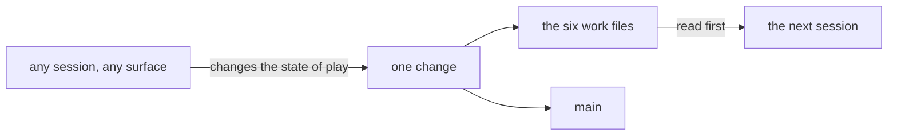

# SR-LAW-10 — L10 — the work files are always up to date, wherever lockmaster is used

## §1 — For humans

**The law (L10).**

> **In every repository lockmaster is installed in, six files are always up to date:** `work/OPEN-WORK.md`, `work/BACKLOG.md`, `work/INTERVIEW.md`, `work/MACHINE.md`, `work/LESSONS.md` and `work/WORKLOG.md`. This binds whoever works there — any session, any agent, Claude Code or Cowork, main agent or sub-agent. A session that changes the state of play changes these files in the same change, before it ends.

**Ruled by Arpit, 2026-11-05 (Cowork):** *"open work, backlog, interview, machine, lessons, worklog should always be upto date who so ever uses lockmaster."*

**Why it exists.** These files are the only memory one session leaves the next. When they drift from git, the next session starts from a wrong picture and the decider is asked things that are already settled.



<details>
<summary><b>ASCII twin</b></summary>

```text
   any session, any surface --changes the state of play--> one change
   one change --> the six work files      one change --> main
   the six work files --read first--> the next session
```

</details>

---

## §2 — For agents

### Context

lockmaster ships the work system with it, and every landing now happens continuously. The 2026-10-30 briefing found the docs claiming more than git showed — `IMPLEMENTATION.md` called W-11 closed, and `INTERVIEW.md` called milo and sheetpane adopted, while neither had landed. A law makes keeping these files current a duty that outranks any task.

### Decision

1. **The six files are always current**, in every repository lockmaster is installed in — not only lockmaster's own.
2. **What "current" means for each one is stated once, elsewhere, and is not restated here:**

   | file | its rule |
   |---|---|
   | `work/OPEN-WORK.md` | [SR-WORK-OPEN-QUEUE](0051_WORK-open-queue.md) |
   | `work/BACKLOG.md` | [SR-WORK-BACKLOG](0052_WORK-backlog.md) |
   | `work/INTERVIEW.md` | [SR-WORK-SESSION](0054_WORK-session.md) decision 3 |
   | `work/WORKLOG.md` | [SR-WORK-SESSION](0054_WORK-session.md) decisions 1–2 |
   | `work/MACHINE.md` | its budget section: [SR-LAW-2](0004_LAW-2-machine-budget.md); its other rows: [SR-WORK-REGISTRY](0060_WORK-registry.md) §3, its trigger |
   | `work/LESSONS.md` | [SR-WORK-REGISTRY](0060_WORK-registry.md) §3, its trigger |

3. **Whoever works there.** No session is exempt for its surface, its model, being a sub-agent, being short, or being "only a chat". A surface that cannot commit still writes them and hands them off with the rest of its change ([SR-ARCHITECTURE](0101_architecture.md) decision 19).
4. **Same change, before the session ends.** An update to a work file travels with the work it describes. It is never a separate later task.
5. **Ground truth wins.** A line in one of the six that disagrees with git is fixed as soon as it is found, by whoever finds it.
6. **A repository lockmaster is installed in has all six.** If one is missing, it is a breach, not an exemption.

### Consequences

- A law outranks every record ([SR-LAW-0](0002_LAW-0-authority.md)). Where a hook skips a repository because it lacks the work system, that skip is the gap this law closes.
- **What enforces it today:** judgment, plus `require-progress.sh`, which nudges for `work/NOW.md` only. `install` does not create the six files, and no hook or `doctor` check names a missing or stale one. Closing that is [W-15](../work/open/W-15-work-files-current-everywhere.md).
- **What a check can never prove:** whether a lesson, a machine quirk or a backlog row should have been written at all. For those three files the law binds judgment.

### Alternatives considered

- Leaving it to SR-WORK-SESSION and SR-WORK-DOCS — rejected: those bind lockmaster's own sessions, as process; the decider wants a duty that travels with the tool into every repository and outranks any task.
- Restating each file's rule here — rejected under L0: one home per rule.

### Reference (required)

- [`kit/claude/hooks/require-progress.sh`](../kit/claude/hooks/require-progress.sh) — the one existing nudge, for `work/NOW.md`.
- [SR-WORK-REGISTRY](0060_WORK-registry.md) §3 — each work file's trigger.

### Veto condition

**Reopen this decision if:** a repository lockmaster is installed in lacks one of the six files, or a session's landings change the state of play with no landing touching `work/WORKLOG.md`.

**How to check it:** `for f in OPEN-WORK BACKLOG INTERVIEW MACHINE LESSONS WORKLOG; do test -f work/$f.md || echo "missing work/$f.md"; done` prints nothing; `PYTHONPATH=src python3 -m lockmaster doctor` names a missing or stale work file once [W-15](../work/open/W-15-work-files-current-everywhere.md) lands.

---

## References

**Records** — [SR-LAWS](0001_LAWS.md) · [SR-LAW-0](0002_LAW-0-authority.md) · [SR-LAW-2](0004_LAW-2-machine-budget.md) · [SR-WORK-OPEN-QUEUE](0051_WORK-open-queue.md) · [SR-WORK-BACKLOG](0052_WORK-backlog.md) · [SR-WORK-SESSION](0054_WORK-session.md) · [SR-WORK-REGISTRY](0060_WORK-registry.md) · [SR-ARCHITECTURE](0101_architecture.md)

**Code**

- [`kit/claude/hooks/require-progress.sh`](../kit/claude/hooks/require-progress.sh)

**Project docs**

- [`work/open/W-15-work-files-current-everywhere.md`](../work/open/W-15-work-files-current-everywhere.md)
