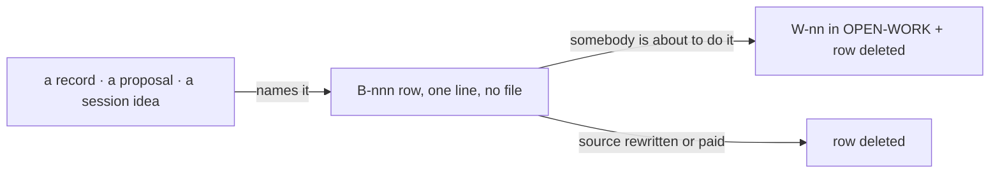

# SR-WORK-BACKLOG — how the backlog works

## §1 — For humans

**`work/BACKLOG.md` lists what has been named and nobody is doing.** Each
`B-nnn` row points at the record, proposal or session note that named it, says
what would close it, and sits under one of five classes: `unbuilt`, `ungated`,
`unmeasured`, `unruled`, `cost`.

**Its length is not a signal.** A long backlog means the records are honest
about what they leave outstanding; it is never trimmed to look better.

**An item is never in both lists.** The moment someone picks it up it becomes a
`W-nn` in the queue, and its backlog row is deleted in the same change.



<details>
<summary><b>ASCII twin</b> — the same diagram, for terminals and diffs</summary>

```text
   a record / a proposal / a session idea
        | names it
        v
   B-nnn row (one line, no file) --about to be done--> W-nn in OPEN-WORK + row deleted
        |
        '--source rewritten, or cost paid--> row deleted
```

</details>

---

## §2 — For agents

### Context

Outstanding work named inside a record's Consequences is invisible to a session
reading the queue, and filing it straight into the queue would bury real work
under things nobody intends to do yet.

### Decision — the backlog discipline (normative)

1. `work/BACKLOG.md` is the single list of named-but-unclaimed work.
   Everything in it is stated somewhere else; nothing in it is being done.
2. It is an index of pointers, not a home. The source is the authority.
3. **Its length is not a signal** — it inverts the queue's rule 3. A longer
   backlog means more honest records. Never trim it to look better.
4. It carries no rule text.
5. It is not evidence and not a commitment.
6. Three sources only: a record naming something outstanding; every file in
   `work/proposals/`; an idea from a session that earns neither.
7. **An item is never in both `BACKLOG.md` and `OPEN-WORK.md`.** The queue
   wins; the moment it has a `W-nn`, its backlog row is gone.
8. A live fork with two implementations is a `compare/` doc, not a row.
9. A veto condition is not a backlog item. 10. A rejected alternative is not
   one; *deferred, not dismissed* is.
11. `B-nnn` ids, filing order, never reused.
12. **No detail file.** The source is the brief.
13. One line, ≤ 400 characters, no body.
14. A row is: id · the outstanding thing in the source's words · the source
    cited by name with a link and a location inside it · what would close it.
    The class is the group heading.
15. Every row cites a source that exists and a location inside it.
16. Every row names what would close it.
17–21. **Five classes, exhaustive:** `unbuilt` (ratified, not implemented) ·
    `ungated` (a rule nothing checks) · `unmeasured` (a default or claim with
    no measurement) · `unruled` (a fork not decided — **only the decider closes
    one**) · `cost` (a consequence accepted deliberately — **never
    graduates**; leaves when paid or when its decision reopens).
22. One class per row: what would have to happen first.
23. Promotion = opening a `W-nn` (file, row, ball) **and deleting the backlog
    row in the same change**.
24. Deleted, never ticked; a row has no file, so only its id is mapped, in
    `archive/README.md` ([SR-WORK-ARCHIVE](0057_WORK-archive.md) decision 3).
25. Check what the row was the only home of before deleting it.
26. A row whose source is rewritten so the item no longer exists is deleted in
    that change.
27. A proposal's row follows its proposal: `graduated` and parked → stays,
    names the successor; `rejected` or gone → the row goes.
28. Grouped by class, then by source. No priority order here.
29. **A record that names something outstanding gets its backlog row in the
    same change.** The one obligation this record adds.
30. Nothing regenerates this file; *named as outstanding* is a judgment.
31. A law, then the queue, outrank this record.

### Consequences

- Nothing mechanical enforces this record; every rule is judgment, including the
  one obligation it adds (decision 29).
- Rows have no detail file, so a row is only as good as the source it points at.

### Alternatives considered

- One list for named and claimed work — rejected: the queue's length would stop
  meaning *pending*.
- A detail file per backlog row — rejected: the source is the brief (decision
  12); a second brief drifts.

### Reference (required)

- [`work/BACKLOG.md`](../work/BACKLOG.md) — the list.
- [`work/proposals/README.md`](../work/proposals/README.md) — every proposal
  carries one row.

### Veto condition

**Reopen this decision if:** a backlog row cites a source that does not exist.

**How to check it:** `cd work && grep -oE '\]\(\.\./[^)#]+' BACKLOG.md | cut -c3- | sort -u | while read p; do [ -e "$p" ] || echo "missing: $p"; done` must print nothing.

---

## References

*Every source this record cites, gathered in one place. An archived document is never listed here.*

**Records** — [SR-WORK-OPEN-QUEUE](0051_WORK-open-queue.md) · [SR-WORK-LIFECYCLE](0053_WORK-lifecycle.md)

**Project docs**

- [`work/BACKLOG.md`](../work/BACKLOG.md) · [`work/proposals/README.md`](../work/proposals/README.md)
