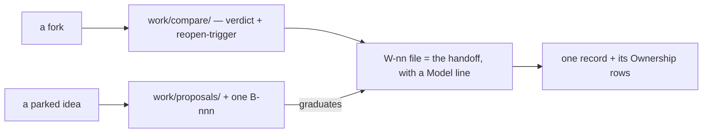

# SR-WORK-LIFECYCLE — how a feature travels

## §1 — For humans

**A feature moves through a fixed set of documents.** A real fork gets a
`work/compare/` doc with a verdict and a reopen-trigger; a parked idea gets a
`work/proposals/` doc with a graduation trigger and one backlog row; the work
itself gets a `W-nn` whose detail file is the handoff.

**Every handoff names the model that should run it** — Opus when the output's
quality is the deliverable and no check would catch a bad one, Sonnet when a
definition of done can verify it, Haiku for mechanical bulk edits.

**It ends in one record**, written from `records/TEMPLATE.md`, with its
components claimed in the register's Ownership table in the same change.



<details>
<summary><b>ASCII twin</b> — the same diagram, for terminals and diffs</summary>

```text
   a fork ------> work/compare/ (verdict + reopen-trigger) --.
                                                            v
   a parked idea -> work/proposals/ + one B-nnn --graduates--> W-nn file = the handoff (Model line)
                                                            |
                                                            v
                                          one record + its Ownership rows
```

</details>

---

## §2 — For agents

### Context

Without a fixed path, the reasoning behind a feature scatters across chats, and
the next session cannot tell a decided fork from an open one.

### Decision — the lifecycle discipline (normative)

1. **On a fork, a compare doc first** — `work/compare/<name>.compare.md`:
   verdict block on top, context, options, matrix, consequences, references,
   **reopen-trigger** (a condition, not a date). The decider accepts or overrides the
   verdict.
2. **On a parked idea, a proposal** — `work/proposals/<name>.md`, `status:
   proposed`, with a **graduation trigger**. Every proposal has one `B-nnn` row.
3. The design of record is the record itself, updated **before** building.
4. **The handoff lives in the item's own detail file** — context, definition
   of done, constraints, key files, edge cases, open questions. There is no
   handoff directory.
5. The prompt is paste-ready and sits beside its handoff: explore → plan →
   implement → verify.
6. **Every handoff names the model that should execute it** — a `**Model:**`
   line with one sentence of why. `**Model:** NONE — <who, and why>` is legal;
   a blank is the only wrong answer.
7. By task: **Opus** when the output quality *is* the deliverable and no test
   catches a bad one (design, debate, ambiguous diagnosis, calling a gate,
   anything touching a law) · **Sonnet** for a written definition of done with
   checks to verify it · **Haiku** for mechanical bulk edits with an exact rule.
8. When borderline, say Opus and say why it was close.
9. One feature, one record, written from `records/TEMPLATE.md` on completion,
   with its components added to the ownership table in the same change.
10. Every rule, record and material decision carries a reference.
11. An implemented proposal is archived in the change that writes its record.

### Consequences

- Nothing mechanical enforces this record; the model line, the compare doc and
  the record-on-completion are judgment.
- The design of record is updated before building (decision 3), so the commit
  guard sees the record touched in the same change as the code.

### Alternatives considered

- A separate handoff directory — rejected: a second document beside the item
  file drifts (decision 4).
- Leaving the model choice to whoever picks the item up — rejected: whoever
  files it knows best whether a check will catch a bad result.

### Reference (required)

- [`work/open/README.md`](../work/open/README.md) — the item file that carries
  the handoff.
- [`records/TEMPLATE.md`](TEMPLATE.md) — the shape of the finished record.

### Veto condition

**Reopen this decision if:** an open item file carries no `**Model:**` line.

**How to check it:** `grep -L '^\*\*Model:\*\*' work/open/W-*.md 2>/dev/null` must print nothing.

---

## References

*Every source this record cites, gathered in one place. An archived document is never listed here.*

**Records** — [SR-WORK-OPEN-QUEUE](0051_WORK-open-queue.md) · [SR-WORK-BACKLOG](0052_WORK-backlog.md) · [SR-WORK-OWNERSHIP](0058_WORK-ownership.md)

**Project docs**

- [`work/compare/README.md`](../work/compare/README.md) · [`work/proposals/README.md`](../work/proposals/README.md) · [`work/open/README.md`](../work/open/README.md) · [`records/TEMPLATE.md`](TEMPLATE.md)
