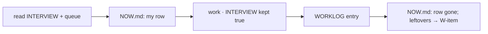

# SR-WORK-SESSION — what a session owes

## §1 — For humans

**A session leaves the repo better than it found it.** Before it ends it
appends one `work/WORKLOG.md` entry; while it works it keeps
`work/INTERVIEW.md` true and `work/NOW.md` holding only what is live — empty
when nothing runs — so a session that dies
mid-task leaves a note, not a mystery.

**It speaks in markers, not summaries** — `→ W-nn: …` on start,
`✓ W-nn · → next` on finish — and leads every answer with the answer, in ten
lines or fewer unless more was asked.

**A failure that happens twice becomes a check**, in the change that records
the second occurrence.



<details>
<summary><b>ASCII twin</b> — the same diagram, for terminals and diffs</summary>

```text
   read INTERVIEW + queue --> NOW.md (in flight) --> work, INTERVIEW kept true
                                                          |
                                     NOW.md: idle <-- WORKLOG entry
```

</details>

---

## §2 — For agents

### Context

Sessions start cold and end abruptly. What one session learned is lost unless it
is written where the next one reads first, and written while the work happens,
not after.

### Decision — the session discipline (normative)

1. **Every session appends one worklog entry before it ends** —
   `work/WORKLOG.md`: asked, done, decided or left open, the single next step.
   A chat-only session counts.
2. The worklog is append-only, newest on top; a wrong old entry is corrected
   by a new one.
3. **`work/INTERVIEW.md` is kept current DURING the session.** Four
   maintained sections: state of play · in flight and the immediate next step ·
   standing constraints · lessons learned.
4. **`work/IMPLEMENTATION.md` is the evidence store** the queue reconciles
   against. A row is earned by landing, never by being planned.
5. **`work/NOW.md` is [SR-WORK-NOW](0061_WORK-now.md)'s** — only what is being worked on
   right now, empty when nothing is; a session keeps its own row true.
6. **Announce every transition in one line — a marker, never a summary.**
   `→ W-nn: building the parser` on start; `✓ W-nn · → W-mm: …` on finish.
   A finish with no next is a stop, and a stop is its own sentence.
7. Keep a todo list for anything with more than two steps, current during the
   work.
8. **Ten lines or fewer unless more was asked for, and lead with the answer.**
9. Never summarise work you just did — the diff showed it. No closing offers.
10. **Concurrent sessions are real.** Re-derive `git status` right before
    staging; re-apply your `work/*.md` edits right before committing; commit
    with explicit pathspecs when the index carries another session's work.
11. **Ground truth over prose.** Before any status claim, check `git log`,
    the code, or a command that reproduces it.
12. Say what you are running, and when, to anyone sharing the machine.
13. 🔴 **Two strikes → a gate.** A failure class the worklog records twice
    becomes a check — a hook, a script, or (once tests exist) a test — **in the
    same change that records the second occurrence.**
14. The worklog is cut at each major release into `archive/worklog/`.

### Consequences

- Decision 5 points at [SR-WORK-NOW](0061_WORK-now.md), which owns `.claude/hooks/now-ledger.py`.
- Decision 5 is nudged by `.claude/hooks/require-progress.sh`: a Stop hook that
  blocks once when the tree changed and `work/NOW.md` did not, then relents.
- Every other decision — the worklog entry, INTERVIEW kept current, answer
  length, the two-strikes gate — is judgment.
- The worklog only grows; decision 14 cuts it at each major release.

### Alternatives considered

- An end-of-session summary only — rejected: a session that dies never writes
  it (decision 5).
- Closing recaps in chat — rejected: the diff already shows the work
  (decision 9).

### Reference (required)

- [`.claude/hooks/require-progress.sh`](../.claude/hooks/require-progress.sh) —
  decision 5's nudge.
- [`work/WORKLOG.md`](../work/WORKLOG.md), [`work/INTERVIEW.md`](../work/INTERVIEW.md),
  [`work/NOW.md`](../work/NOW.md) — the three files a session owes.

### Veto condition

**Reopen this decision if:** the newest worklog entry is older than the newest commit.

**How to check it:** `echo "commit $(git log -1 --format=%cs) · worklog $(grep -m1 -oE '^## [0-9-]{10}' work/WORKLOG.md)"` — the worklog date must not be earlier.

---

## References

*Every source this record cites, gathered in one place. An archived document is never listed here.*

**Records** — [SR-WORK-OPEN-QUEUE](0051_WORK-open-queue.md) · [SR-WORK-DOCS](0055_WORK-docs.md)

**Code**

- [`.claude/hooks/require-progress.sh`](../.claude/hooks/require-progress.sh)

**Project docs**

- [`work/WORKLOG.md`](../work/WORKLOG.md) · [`work/INTERVIEW.md`](../work/INTERVIEW.md) · [`work/NOW.md`](../work/NOW.md) · [`work/IMPLEMENTATION.md`](../work/IMPLEMENTATION.md)
