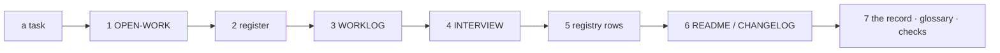

# SR-WORK-DOCS — the documentation contract

## §1 — For humans

**Docs here are written to be scanned.** Short points, one idea each, the
takeaway first, tables for comparisons; a wall of text is split by whoever
touches it.

**An agent may edit the agent-steering files, `CLAUDE.md` included, directly**
— it says so out loud in its output and worklog, and acts only on a ruling of
the decider's or a fact.

**Every task updates a fixed list of documents before it is done**, in order:
the queue, the register, the worklog, the interview, any registry row, the
public docs, the record.



<details>
<summary><b>ASCII twin</b> — the same diagram, for terminals and diffs</summary>

```text
   a task -> 1 OPEN-WORK -> 2 register -> 3 WORKLOG -> 4 INTERVIEW
          -> 5 registry rows -> 6 README / CHANGELOG -> 7 the record, glossary, checks
```

</details>

---

## §2 — For agents

### Context

Long paragraphs hide the rule a reader came for, and a task that leaves the
steering documents behind leaves the next session acting on yesterday's state.

### Decision — the documentation discipline (normative)

1. No large paragraphs: 3–4 lines, one idea per point.
2. Roomy: blank lines, tables for comparisons, headings.
3. Lead each point with the takeaway, bolded where it helps scanning.
4. Fix form on contact — a wall of text you touch, you split.
5. Chat answers follow the same rule.
6. **An agent may edit the agent-steering files directly**, `CLAUDE.md`
   included — no proposal step.
7. Under two obligations, both judgment: **(a) say it out loud** — a change to
   `CLAUDE.md` is named in the session output and the worklog entry; **(b) a
   ruling of the decider's, or a fact** — never latitude you were not given.
8. Statements of fact are exempt from every ceremony: fixed on contact.
9. The split is `docs/` (what the project *is*) and `work/` (what is
   *happening* to it). `work/README.md` is the map.
10. **Every task updates, before it is done, in this order:** (1)
    `work/OPEN-WORK.md` · (2) the register · (3) `work/WORKLOG.md` · (4)
    `work/INTERVIEW.md` · (5) the registry row of any doc touched · (6)
    `README.md` / `CHANGELOG.md` when public-facing · (7) the relevant record,
    the glossary for any new term, every check the change needs.
11. The registry's rules are `SR-WORK-REGISTRY`'s.
12. Every relative link in a live document resolves (judgment until a link
    test exists).
13. Durable repo-wide knowledge is folded into `CLAUDE.md` concisely, as a
    pointer to its record.

### Consequences

- Nothing mechanical enforces this record; form, the steering-file obligations
  and the update order are judgment.
- Decision 12 (every relative link resolves) is judgment until a link test
  exists.

### Alternatives considered

- A proposal step before any `CLAUDE.md` edit — rejected: it slows the fixes
  that keep steering true; saying it out loud (decision 7a) covers the risk.

### Reference (required)

- [`CLAUDE.md`](../CLAUDE.md) and [`work/README.md`](../work/README.md) — the
  steering files this record governs.
- [SR-WORK-REGISTRY](0060_WORK-registry.md) §3 — the registry decision 10
  step 5 bumps.

### Veto condition

**Reopen this decision if:** `CLAUDE.md` changes in a commit dated after the newest worklog entry that names it.

**How to check it:** `git log -1 --format=%cs -- CLAUDE.md` against `grep -m1 -B20 'CLAUDE.md' work/WORKLOG.md | grep -oE '^## [0-9-]{10}' | tail -1`.

---

## References

*Every source this record cites, gathered in one place. An archived document is never listed here.*

**Records** — [SR-WORK-REGISTRY](0060_WORK-registry.md) · [SR-WORK-SESSION](0054_WORK-session.md) · [SR-LAW-0](0002_LAW-0-authority.md)

**Project docs**

- [`CLAUDE.md`](../CLAUDE.md) · [`work/README.md`](../work/README.md) · [`docs/GLOSSARY.md`](../docs/GLOSSARY.md)
