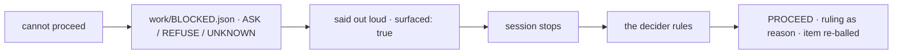

# SR-WORK-BLOCKERS — a blocker is a file, not a remark

## §1 — For humans

**When a session cannot go on without the decider, it writes
`work/BLOCKED.json` and stops.** The file says what kind of block it is
(`ASK`, `REFUSE`, `UNKNOWN`), the minimum question, and what can safely be done
meanwhile.

**Hooks keep a blocker from being walked past.** Every prompt shows the open
blocker and the inbox; a turn cannot end while a blocker is unsurfaced (three
refusals, then it relents); writes take a per-file lock so two sessions do not
edit the same asset.

**When the decider rules**, the file goes back to `PROCEED` with the ruling as
its reason.



<details>
<summary><b>ASCII twin</b> — the same diagram, for terminals and diffs</summary>

```text
   cannot proceed --> work/BLOCKED.json (ASK|REFUSE|UNKNOWN) --> said out loud, surfaced: true
                                                                      |
   PROCEED, ruling as reason, item re-balled <-- the decider rules <-- session stops
```

</details>

---

## §2 — For agents

### Context

A blocker mentioned in passing is forgotten by the next prompt, and an agent
that works around one makes the decision it was waiting for.

### Decision — the blocker discipline (normative)

1. **A blocker is a file, not a remark.** The moment you cannot proceed
   without the decider, write `work/BLOCKED.json` and stop.
2. Shape:
   ```json
   {"decision":"ASK","reason":"one line","questions":["the minimum question"],
    "safe_alternative":"what you can do meanwhile, or \"\"","surfaced":false,"filed":"YYYY-MM-DD"}
   ```
3. `decision` takes exactly four values — `ASK` (the decider can unblock you) ·
   `REFUSE` (disallowed or unsafe) · `UNKNOWN` (out of scope to answer
   reliably) · `PROCEED` (nothing is blocked).
4. `questions` carries the **minimum** question.
5. `safe_alternative` is what can be done meanwhile — never a guess at what the decider
   would have said.
6. **Do not work around a blocker.** Say it, set `surfaced: true`, stop.
7. Three hooks enforce it: `UserPromptSubmit` injects the blocker and the
   inbox into every prompt, each inbox row with its age computed from its
   `filed` date (`inject-inbox.sh`, which reads any `## Blocked on …` heading and
   computes age only where the queue keeps no `age` column — W-09); `Stop` refuses to end a turn
   while a blocker is unsurfaced, three times, then relents
   (`stop-if-blocked.sh`); `PreToolUse` on writes is a **per-asset** lock
   (`session-lock.sh`, TTL 900 s).
8. The `Stop` hook relents after three refusals deliberately — a hook that
   never relents is a hang. Taking the third exit while still blocked breaks
   rule 6.
9. The lock is per asset, not per session; two sessions are expected.
9a. **Cleaning a lock is [SR-WORK-CLEANUP](0062_WORK-cleanup.md)'s** (decisions 8–10). The
    lock itself stays here: `session-lock.sh` keys it by the hook input's `session_id`.
10. When the decider rules, the file is set back to `PROCEED` with the ruling as
    `reason` and the resulting item re-balled in the same change.

### Consequences

- Decision 7 is enforced by three hooks: `inject-inbox.sh` (UserPromptSubmit),
  `stop-if-blocked.sh` (Stop) and `session-lock.sh` (PreToolUse on writes,
  TTL 900 s). All three need `jq`. The lock's owner is the hook input's
  `session_id` (2026-10-20: keyed on `$PPID`, which changes per tool call, a
  session locked itself out of its own files).
- The Stop hook relents after three refusals (decision 8) — backlog row B-002,
  a `cost`.
- Decisions 4–6 and 10 — the minimum question, no workarounds, the re-ball on a
  ruling — are judgment.

### Alternatives considered

- A blocker as a line in chat — rejected: it scrolls away.
- A Stop hook that never relents — rejected: a hook that never relents is a
  hang.

### Reference (required)

- [`.claude/hooks/inject-inbox.sh`](../.claude/hooks/inject-inbox.sh),
  [`.claude/hooks/stop-if-blocked.sh`](../.claude/hooks/stop-if-blocked.sh),
  [`.claude/hooks/session-lock.sh`](../.claude/hooks/session-lock.sh) — decision 7.
- [`.claude/settings.json`](../.claude/settings.json) — their wiring.

### Veto condition

**Reopen this decision if:** `work/BLOCKED.json` holds a decision other than `PROCEED` with `surfaced: false` after a session has ended.

**How to check it:** `jq '{decision, surfaced}' work/BLOCKED.json`.

---

## References

*Every source this record cites, gathered in one place. An archived document is never listed here.*

**Records** — [SR-WORK-OPEN-QUEUE](0051_WORK-open-queue.md) · [SR-WORK-SESSION](0054_WORK-session.md)

**Code**

- [`.claude/hooks/inject-inbox.sh`](../.claude/hooks/inject-inbox.sh)
- [`.claude/hooks/stop-if-blocked.sh`](../.claude/hooks/stop-if-blocked.sh)
- [`.claude/hooks/session-lock.sh`](../.claude/hooks/session-lock.sh)
- [`.claude/settings.json`](../.claude/settings.json)

**Project docs**

- [`work/BLOCKED.json`](../work/BLOCKED.json)
