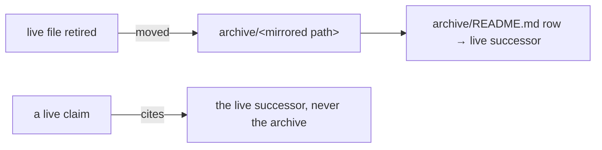

# SR-WORK-ARCHIVE — one archive, named never cited

## §1 — For humans

**There is one archive, `archive/` at the repo root.** Anything retired — a
closed item's file, a retired record, a decided fork, an implemented proposal —
is moved there into a directory mirroring where it came from, with a row in
`archive/README.md` naming its live successor.

**Archive is not evidence.** An archived document may be named, with a link; it
never backs a live claim, because nothing guarantees it was not edited after
retirement. Links inside it are never repaired.



<details>
<summary><b>ASCII twin</b> — the same diagram, for terminals and diffs</summary>

```text
   live file retired --moved--> archive/<mirrored path> --> archive/README.md row -> live successor
   a live claim --cites--> the live successor, never the archive
```

</details>

---

## §2 — For agents

### Context

Deleting history loses the reasoning; leaving it in the live tree lets a
session cite it as current. One frozen tree with a map solves both.

### Decision — the archive discipline (normative)

1. Exactly one archive: `archive/` at the repo root.
2. Anything archived is **moved** there into a directory mirroring where it
   came from (`archive/open/`, `archive/records/`, `archive/compare/`, …).
3. Every archived document gets a row in `archive/README.md` naming its live
   successor, or saying it has none. **So does every deleted backlog id** that
   a document still names: a row in the map's `backlog/` section naming the
   item or test that absorbed it.
4. An archived document may be **named** in prose, with a link.
5. It may **never back a live claim** — nothing guarantees it was not
   overwritten after retirement.
6. When repointing a citation away from an archived doc, point at the live
   successor; never just delete the link.
7. If an archived doc was a claim's only support, the claim needs new
   grounding.
8. A superseded record is never archived (rewritten or deleted); a **retired**
   record is archived (L1).
9. Links inside `archive/` are never repaired; the tree is frozen.

### Consequences

- Decision 1 is checked in CI (job `lint`) by `scripts/check-work-system.py`:
  a directory named `archive` anywhere but the root fails it (`.git/`,
  `target/`, `node_modules/` and worktrees aside). The same script fails a
  `B-nnn` named in `CLAUDE.md`, `README.md`, `RELEASING.md`, `work/`,
  `records/` or `docs/` that is neither a row of `work/BACKLOG.md` nor named in
  `archive/README.md` (decision 3, for backlog ids). Nothing mechanical
  enforces the rest of this record.
- A citation to an archived document is judgment until a link test exists.

### Alternatives considered

- An archive per subtree — rejected: a session cannot know every place to look,
  and a second archive is the first one going stale.
- Deleting closed material and relying on git — rejected: a cold session does
  not read history.

### Reference (required)

- [`archive/README.md`](../archive/README.md) — the map.
- [SR-LAW-1](0003_LAW-1-retired-records-archived.md) — retired records.

### Veto condition

**Reopen this decision if:** a second `archive/` directory exists anywhere in the tree.

**How to check it:** `find . -type d -name archive -not -path './.git/*' -not -path '*/node_modules/*'` must print only `./archive`.

---

## References

*Every source this record cites, gathered in one place. An archived document is never listed here.*

**Records** — [SR-LAW-1](0003_LAW-1-retired-records-archived.md) · [SR-WORK-OPEN-QUEUE](0051_WORK-open-queue.md)

**Project docs**

- [`archive/README.md`](../archive/README.md)
