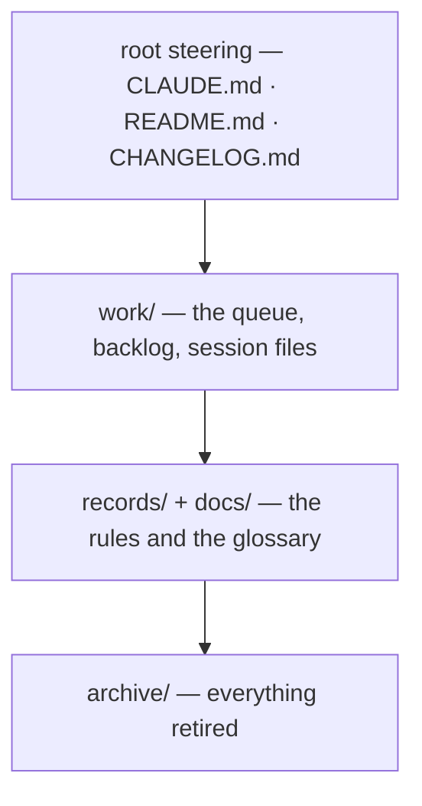

# SR-WORK-GOVERNANCE — the governance map

## §1 — For humans

**Every file that governs work sits in exactly one of four layers**: root
steering, `work/`, `records/` + `docs/`, and `archive/`. The map below names
each layer's files, its audience, what enforces it, and when it must change.

**The map names homes and restates no rule, and it carries no counts** — a
count in prose is a fact with an expiry date.



<details>
<summary><b>ASCII twin</b> — the same diagram, for terminals and diffs</summary>

```text
   +------------------------------------------------------+
   | root steering   CLAUDE.md · README.md · CHANGELOG.md |
   | work/           the queue, backlog, session files    |
   | records/+docs/  the rules and the glossary           |
   | archive/        everything retired                   |
   +------------------------------------------------------+
```

</details>

---

## §2 — For agents

### Context

A newcomer needs to know which file is authoritative for what before reading
any of them.

### Decision — the governance discipline (normative)

Four layers; every governing file sits in exactly one. The map names homes
and restates no rule. **It carries no counts** — a count in prose is a fact
with an expiry date.

| layer | files | audience | enforced by | update trigger |
|---|---|---|---|---|
| root steering | `CLAUDE.md` · `README.md` · `CHANGELOG.md` | agent / human | hooks + guard | any rule or pointer changes |
| `work/` | `OPEN-WORK.md` · `BACKLOG.md` · `open/` · `BLOCKED.json` · `NOW.md` · `WORKLOG.md` · `INTERVIEW.md` · `IMPLEMENTATION.md` · `LESSONS.md` · `MACHINE.md` · `compare/` · `proposals/` | both | hooks (`inject-inbox`, `stop-if-blocked`, `require-progress`, `session-lock`, `release-locks`, `worktree-cleanup`, `now-ledger`, `disk-budget`, `guard-open-work-inbox`) | the same change as the work |
| `records/` + `docs/` | `records/README.md` (register) · `records/NNNN_*.md` · `records/TEMPLATE.md` · `records/RULE-SINCE` · `docs/GLOSSARY.md` | both | `scripts/sr-guard.sh` | the owning code or the decision changes |
| `archive/` | everything retired, mirroring the live tree | both | judgment (no second `archive/` anywhere) | a closure or a retirement |

A governing file gets its row in the change that adds it and loses it in the
change that retires it.

### Consequences

- Nothing mechanical enforces the map; a governing file gets its row by
  judgment in the change that adds it.

### Alternatives considered

- The map inside `CLAUDE.md` — rejected: it would restate the records (L0);
  `CLAUDE.md` points here instead.

### Reference (required)

- [`CLAUDE.md`](../CLAUDE.md), [`work/README.md`](../work/README.md),
  [`records/README.md`](README.md), [`archive/README.md`](../archive/README.md)
  — the entry file of each layer.

### Veto condition

**Reopen this decision if:** a governing file exists that no layer of the map names.

**How to check it:** `ls CLAUDE.md work records docs archive .claude/hooks scripts` against the table under Decision.

---

## References

*Every source this record cites, gathered in one place. An archived document is never listed here.*

**Records** — [SR-WORK-OWNERSHIP](0058_WORK-ownership.md) · [SR-WORK-REGISTRY](0060_WORK-registry.md)

**Project docs**

- [`CLAUDE.md`](../CLAUDE.md) · [`work/README.md`](../work/README.md) · [`records/README.md`](README.md) · [`archive/README.md`](../archive/README.md)
