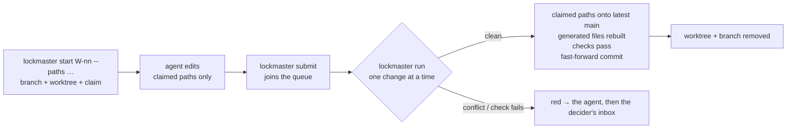

# SR-ARCHITECTURE — lockmaster lands agent changes into main, one at a time

## §1 — For humans

**lockmaster is a doorman for `main`.** Agents never commit to `main`
themselves. Each one says which files it will touch, works in its own
throwaway folder, and hands its change in. lockmaster puts the changes onto
`main` **one at a time** — like a canal lock-keeper letting one boat through —
and cleans up after each.

**It is not a new version control system.** Every landing is an ordinary git
commit; `git log` reads the history with nothing else installed.

**It never loses work.** It never forces anything. A change that cannot land
cleanly — a real conflict, a failed check, a file that would be lost — stops
**red** and goes to the decider.



<details>
<summary><b>ASCII twin</b></summary>

```text
   start (branch + worktree + claim) --> agent edits claimed paths --> submit (queue)
                                                                          |
                                         run: one change at a time <------+
                                           | clean: claimed paths onto latest main,
                                           |        generated files rebuilt, checks,
                                           |        fast-forward commit, worktree removed
                                           | conflict / failed check: red -> agent -> decider
```

</details>

---

## §2 — For agents

### Context

On one laptop, several agents work in one repository at once. The work
system's own logs (fux, sheetpane, codelaw, 2026-09 to 2026-10) recorded the
same failures again and again: one session's commit swept another session's
staged files; generated files (`CHANGELOG.md`, `llms-full.txt`, an index)
conflicted whenever two agents touched them; worktrees piled up until the disk
filled; finished work sat on branches nobody merged; `NOW.md` and the inbox,
edited by hand, stopped matching git. Anthropic's own answer at
30,000 merges a day was a new, server-side source-control system; at one laptop
the same ideas fit on top of git (`work/compare/source-control.compare.md`).

### Decision

**What it is**

1. **A command-line tool over plain git, not a version control system.** Every
   landing is an ordinary commit on `main`; history, blame and diff are git's.
   No lockmaster state is needed to read the repository.
2. **Python ≥ 3.9, standard library only** ([SR-LAW-4](0006_LAW-4-zero-dependencies.md)). 3.9 is the `python3` on the
   decider's Mac ([`work/MACHINE.md`](../work/MACHINE.md)); the tool and every
   hook run there unchanged. Code lives in `src/lockmaster/`; the command is
   `lockmaster` (`python3 -m lockmaster` works without installing).
3. **Its state lives inside git's own directory**, at
   `$(git rev-parse --git-common-dir)/lockmaster/` — shared by every worktree,
   never committed, gone with the clone. A change is one JSON file in
   `changes/`; the land lock and the throwaway landing worktrees live there too.

**A change**

4. **A change is a claim:** a work-item id, the paths it may touch (a file, a
   directory above it, or a glob), a branch `lm/<item>` and a worktree at
   `.claude/worktrees/<item>`, kept out of the main checkout's status through
   `info/exclude`. `lockmaster start` creates all three;
   `lockmaster claim add <path>` widens the claim.
5. **Only claimed paths land.** Anything else the branch changed, committed or
   not, is left behind and reported, never swept in. `submit` commits only the
   claimed paths in the worktree. A kit hook (`claim-guard.py`) warns — never
   refuses — when an agent writes inside a change's worktree outside its claim.
6. **`lockmaster submit` queues the change and starts `lockmaster run`
   when no lander holds the land lock;** a lander already running picks the
   change up. Nobody has to remember to land; the lock still keeps it to one
   at a time (ruled 2026-10-25, W-02).

**Landing**

7. **One lander at a time.** `lockmaster run` takes the repo's land lock (a
   `mkdir` mutex in the state directory, holding the lander's pid) and lands
   queued changes oldest first. A second lander exits and leaves the queue to
   the first. A lock whose pid is dead is stale and taken over; a change it
   left mid-landing is queued again — `main` had not moved.
8. **A landing, in order:** take the claimed paths' diff against the change's
   merge base, generated files excluded, as one commit; cherry-pick it onto the
   latest `main` in a fresh worktree in the state directory; rebuild every
   generated file (decision 9); run the repo's checks; commit — the repo's own
   commit hooks run — with the item id in a `Lockmaster-Change:` trailer;
   fast-forward `main`. **When the whole branch landed**, the landing commit
   also records the branch tip as a second parent, so git itself can prove the
   branch merged and `git branch -d` removes it ([SR-LAW-3](0005_LAW-3-never-lose-work.md)
   decision 2). `main` is fast-forwarded where it is checked out
   (`merge --ff-only`, so that checkout moves with it, and refuses to overwrite
   its local edits) or else by `update-ref` against the old value; if `main`
   moved meanwhile, the landing is redone on the new `main`, up to three times.
   Then the change's worktree and branch are removed if nothing in them can be
   lost ([SR-WORK-CLEANUP](0062_WORK-cleanup.md) decisions 1–2); what cannot
   be is kept and reported. A failed attempt's landing worktree is committed
   to its own detached HEAD before it is removed.
9. **Generated files are never merged, only rebuilt.** Each repo lists them,
   with the command that rebuilds each, in `lockmaster.toml` `[generated]`.
   Rebuilding restores each to `main`'s version first — unless it has
   uncommitted edits, which are refused by name, never overwritten — then runs
   its command; a failing command fails the landing. `lockmaster regen` does
   the same by hand.
10. **Hand-written files with a known shape merge structurally** —
    `append-newest-first` (a worklog), `table-rows` (a queue), `append` (a
    lessons file) — as git merge drivers `lockmaster drivers` registers in
    `.git/config`, with `[merge]`'s paths written into a block of
    `.gitattributes` lockmaster owns. When both sides only inserted lines at
    the same place, both insertions are kept: the landing change's on top for
    `append-newest-first`, in landing order otherwise, and a row both sides
    added kept once for `table-rows`. Anything else goes to `git merge-file`,
    so a true conflict still conflicts. Plain `git merge` uses them too.
11. **Red, never forced.** A conflict outside a structural merge, a failed
    rebuild or check, a refused commit, or local edits in `main`'s checkout
    that the fast-forward would overwrite stop that change: it is marked red
    with the reason, and the agent is told — with the inbox row
    ([SR-WORK-OPEN-QUEUE](0051_WORK-open-queue.md) rule 42's shape) ready to
    add if it cannot fix it. lockmaster never forces, deletes an unmerged
    branch, hard-resets, cleans or force-pushes
    ([SR-LAW-3](0005_LAW-3-never-lose-work.md) decision 3). **A red change is
    set aside and the next queued change lands** (ruled 2026-10-25, W-02): one
    bad change does not hold up the rest. It stays in `lockmaster queue`,
    marked red with its reason, until it is fixed and resubmitted or abandoned.
12. **Only lockmaster writes to `main`.** A kit hook (`block-main.py`) refuses
    an agent's `git commit`, `merge`, `cherry-pick`, `revert`, `am` or `rebase`
    while `main` is checked out, and any `git push` that would update `main`.
    lockmaster's own landing runs git inside `lockmaster`, not through the
    agent's shell tool, so it passes. The hook binds agent sessions only: the
    decider's own terminal can still commit to `main`.

**Configuration**

13. **`lockmaster.toml` at the repo root** — `[main]` (the branch), `[checks]`
    (name → command; each must pass), `[generated]` (path or glob → rebuild
    command), `[merge]` (path or glob → structural driver). Four tables of
    string values, nothing else; anything outside that subset is a loud error.
    It is read with `tomllib` on Python ≥ 3.11, checked against lockmaster's
    own reader of the same subset — the reader used on 3.9–3.10 — so a file
    means the same on every Python and no dependency is added.

**Commands**

14. | command | who | what it does |
    |---|---|---|
    | `lockmaster start <item> --paths …` | agent | branch + worktree + claim |
    | `lockmaster claim add <path>` | agent | widen the claim |
    | `lockmaster submit` | agent | join the queue |
    | `lockmaster run` | `submit`, a hook, or anyone | land queued changes, one at a time |
    | `lockmaster queue` | the decider | what is waiting, landed or red |
    | `lockmaster status` | anyone | live sessions, changes, worktrees, disk use against L2's budget; `--now` prints `work/NOW.md` as it should be, `--write-now` writes it |
    | `lockmaster abandon` | agent or the decider | drop a change; remove its worktree and branch only if nothing is lost |
    | `lockmaster doctor` | anyone | stale locks, orphan worktrees, unmerged branches, an installed kit that is not this lockmaster's |
    | `lockmaster install <repo>` | the decider | install a pinned kit into a repository |
    | `lockmaster regen` | anyone | rebuild the `[generated]` files by hand |
    | `lockmaster drivers` | the decider | register the merge drivers; write `[merge]` into `.gitattributes` |

    **`work/NOW.md` is `lockmaster status --now`'s view:** its sessions are the
    sessions' own (the kit's `now-ledger.py` adds and closes them, a Cowork
    session by hand); a resource row whose path is gone leaves; the file is
    written in one shape by every landing and by `now-ledger.py`, which writes
    through lockmaster's renderer when lockmaster is importable.

**The kit**

15. **`kit/` is what lockmaster installs into a repository:** `kit/claude/`
    (the hooks, their `settings.json`, the `docket` skill) becomes the target's
    `.claude/`, and `kit/github/` its `.github/`. One source, installed —
    never three hand-copied versions. `lockmaster install` copies it, merges
    the kit's hook entries into the target's `settings.json` (the target's own
    entries and keys kept), and records the version, the kit's digest and every
    installed file's hash in `.claude/lockmaster.lock`, which `doctor` checks.
    A file the kit would replace that no earlier install wrote stops the
    install by name, or with `--backup` is moved aside first. This repository
    installs its own kit the same way; `scripts/bootstrap.py` is retired
    (2026-10-25, W-06).
16. **What stays in each repository:** its records, work items, backlog,
    worklog, lessons — the project's own papers — and its `lockmaster.toml`.

**Distribution**

17. **Python only, on PyPI only** ([SR-LAW-6](0008_LAW-6-python-only.md)):
    one package, `lockmaster`; no npm package. **The repository stays private
    until 0.1.0** — public once the core loop works (ruled 2026-10-25, W-02);
    a placeholder 0.0.1 on PyPI holds the name before then (W-08).
    **A release is a tag `v<version>`, and only a tag publishes.**
    `.github/workflows/release.yml` — lockmaster's own, never in `kit/` —
    runs the tests on Linux, macOS and Windows under Python 3.9 and 3.13 and
    the work-system checks; checks that the tag, `lockmaster.__version__` (the
    one version source) and a `CHANGELOG.md` section agree
    (`scripts/release.py check`); builds the sdist and wheel, `twine check`s
    them and confirms the wheel carries every kit file; installs the wheel
    alone on every OS and Python, installs the kit into a scratch repository
    with it and lands one change; then publishes to TestPyPI and to PyPI by
    trusted publishing (no stored token), PyPI behind the `pypi` environment's
    reviewer; then creates the GitHub release from the CHANGELOG section.
    `scripts/release.py prepare <version>` cuts a version. The wheel carries
    `kit/` as `lockmaster/kit`, so `lockmaster install` works from a pip
    install.

### Consequences

- Landings are serial by design: on one laptop that is the point (one build at
  a time is also what L2's budget wants), at the cost of a queue that waits.
- Two agents changing the same lines with different intent is still a
  conflict; lockmaster stops and asks, a person decides.
- Decisions 1–17 are built (W-03 to W-07, and the release pipeline) and
  tested on scratch repositories under `tests/`; publishing waits on the
  decider's one-time trusted-publisher setup (W-08).
- `main`'s first-parent chain is exactly the landings; an agent's own commits
  are reachable through a landing's second parent. `git log --first-parent`
  reads the landings alone.
- Distribution is PyPI alone (decision 17); a Node repository runs it through
  `python3`.

### Alternatives considered

- **A new version control system, as Anthropic built for its monorepo** —
  rejected: its own authors call it unsuitable for general use; the problem
  here is concurrency on one machine, not scale.
- **A merge queue on a forge (GitHub's)** — rejected: needs a server round trip
  per change and does not stop the local sweeps, the worktree pile-up or the
  generated-file conflicts.
- **A red change stops the queue until fixed** — rejected by the decider,
  2026-10-25 (W-02): one bad change should not hold up the rest.
- **An npm package beside PyPI** — rejected by the decider, 2026-10-25 (L6).
- **Jujutsu (`jj`) as the front end** — not rejected; held in
  `work/compare/source-control.compare.md` as the fork to reopen.

### Reference (required)

- [`kit/`](../kit) — decisions 5, 12 and 15; [`kit/claude/hooks/claim-guard.py`](../kit/claude/hooks/claim-guard.py) (5), [`kit/claude/hooks/block-main.py`](../kit/claude/hooks/block-main.py) (12).
- [`src/lockmaster/`](../src/lockmaster) — decisions 1–15: `land.py` (4–8, 11), `generated.py` (9), `merge.py` and `drivers.py` (10), `config.py` (13), `status.py` and `now.py` (14), `install.py` and `doctor.py` (14–15).
- [`tests/`](../tests) — one scratch-repo test file per work item that built them.
- [`lockmaster.toml`](../lockmaster.toml) — this repository's own checks and merge drivers (decision 13).
- [`.github/workflows/release.yml`](../.github/workflows/release.yml), [`scripts/release.py`](../scripts/release.py), [`pyproject.toml`](../pyproject.toml) — decision 17.

### Veto condition

**Reopen this decision if:** a landing ever needs a forced git operation, or `main` holds a commit lockmaster did not make while the block-main hook is installed.

**How to check it:** `grep -rnE -- "--force|branch -D|reset --hard|git clean" src kit` prints nothing, and `git log --first-parent --format='%h %(trailers:key=Lockmaster-Change,valueonly)' main` shows a trailer on every commit after the hook's install.

---

## References

**Records** — [SR-LAW-3](0005_LAW-3-never-lose-work.md) · [SR-LAW-4](0006_LAW-4-zero-dependencies.md) · [SR-LAW-6](0008_LAW-6-python-only.md) · [SR-WORK-CLEANUP](0062_WORK-cleanup.md) · [SR-WORK-NOW](0061_WORK-now.md) · [SR-WORK-OPEN-QUEUE](0051_WORK-open-queue.md) · [SR-LAW-2](0004_LAW-2-machine-budget.md)

**Code** — [`src/lockmaster/`](../src/lockmaster) · [`kit/`](../kit) · [`tests/`](../tests) · [`lockmaster.toml`](../lockmaster.toml)

**Project docs** — [`work/compare/source-control.compare.md`](../work/compare/source-control.compare.md) · [`work/MACHINE.md`](../work/MACHINE.md)

**External** — [Redesigning source control at Anthropic](https://www.anthropic.com/engineering/redesigning-source-control) (2026-10-13)
