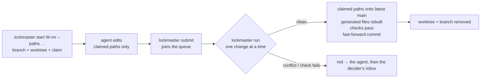

# SR-ARCHITECTURE — lockmaster lands agent changes into main, one at a time

## §1 — For humans

**lockmaster is a doorman for `main`.** Agents never commit to `main`
themselves. Each one says which files it will touch, works in its own
throwaway folder, and hands its change in. lockmaster puts the changes onto
`main` **one at a time** — like a canal lock-keeper letting one boat through —
and cleans up after each.

**It is not a new version control system.** Every landing is an ordinary git
commit; `git log` reads the history with nothing else installed.

**It never loses work.** It never forces anything. A change that cannot land
cleanly — a real conflict, a failed check, a file that would be lost — stops
**red** and goes to the decider.



<details>
<summary><b>ASCII twin</b></summary>

```text
   start (branch + worktree + claim) --> agent edits claimed paths --> submit (queue)
                                                                          |
                                         run: one change at a time <------+
                                           | clean: claimed paths onto latest main,
                                           |        generated files rebuilt, checks,
                                           |        fast-forward commit, worktree removed
                                           | conflict / failed check: red -> agent -> decider
```

</details>

---

## §2 — For agents

### Context

On one laptop, several agents work in one repository at once. The work
system's own logs (fux, sheetpane, codelaw, 2026-09 to 2026-10) recorded the
same failures again and again: one session's commit swept another session's
staged files; generated files (`CHANGELOG.md`, `llms-full.txt`, an index)
conflicted whenever two agents touched them; worktrees piled up until the disk
filled; finished work sat on branches nobody merged; `NOW.md` and the inbox,
edited by hand, stopped matching git. Anthropic's own answer at
30,000 merges a day was a new, server-side source-control system; at one laptop
the same ideas fit on top of git (`work/compare/source-control.compare.md`).

### Decision

**What it is**

1. **A command-line tool over plain git, not a version control system.** Every
   landing is an ordinary commit on `main`; history, blame and diff are git's.
   No lockmaster state is needed to read the repository.
2. **Python ≥ 3.9, standard library only.** 3.9 is the `python3` on the
   decider's Mac ([`work/MACHINE.md`](../work/MACHINE.md)); the tool and every
   hook run there unchanged. Code lives in `src/lockmaster/`; the command is
   `lockmaster` (`python3 -m lockmaster` works without installing).
3. **Its state lives inside git's own directory**, at
   `$(git rev-parse --git-common-dir)/lockmaster/` — shared by every worktree,
   never committed, gone with the clone. A change is one JSON file there.

**A change**

4. **A change is a claim:** a work-item id, the paths it may touch, a branch
   `lm/<item>` and a worktree under `.claude/worktrees/`. `lockmaster start`
   creates all three; `lockmaster claim add <path>` widens the claim.
5. **Only claimed paths land.** Anything else the branch changed is left behind
   and reported, never swept in.
6. **`lockmaster submit` queues the change;** it does not land it.

**Landing**

7. **One lander at a time.** `lockmaster run` takes the repo's land lock (a
   `mkdir` mutex in the state directory) and lands queued changes in order.
8. **A landing, in order:** take the claimed paths' diff against the change's
   merge base; apply it onto the latest `main` in a fresh worktree; restore
   every generated file to `main`'s version and rebuild it with its command;
   run the repo's checks; commit, with the item id in a `Lockmaster-Change:`
   trailer; fast-forward `main`; remove the change's worktree and branch
   ([SR-WORK-CLEANUP](0062_WORK-cleanup.md) decisions 1–2).
9. **Generated files are never merged, only rebuilt.** Each repo lists them,
   with the command that rebuilds each, in `lockmaster.toml` `[generated]`.
10. **Hand-written files with a known shape merge structurally** —
    `append-newest-first` (a worklog), `table-rows` (a queue), `append` (a
    lessons file) — as git merge drivers lockmaster installs; `[merge]` names
    them per path.
11. **Red, never forced.** A conflict outside a structural merge, or a failed
    check, stops that change: it is marked red with the reason, the agent is
    told, and if the agent cannot fix it a row goes into the decider's inbox
    ([SR-WORK-OPEN-QUEUE](0051_WORK-open-queue.md) rule 42's shape). lockmaster
    never runs `--force`, `branch -D`, `reset --hard`, `clean` or a force push.
12. **Only lockmaster writes to `main`.** A hook in the kit refuses a direct
    commit or push to `main` from an agent session.

**Configuration**

13. **`lockmaster.toml` at the repo root** — `[main]` (the branch), `[checks]`
    (commands that must pass), `[generated]` (path → rebuild command),
    `[merge]` (path → structural driver). It is read with `tomllib` on
    Python ≥ 3.11 and with lockmaster's own reader of the same subset on
    3.9–3.10, so no dependency is added.

**Commands**

14. | command | who | what it does |
    |---|---|---|
    | `lockmaster start <item> --paths …` | agent | branch + worktree + claim |
    | `lockmaster claim add <path>` | agent | widen the claim |
    | `lockmaster submit` | agent | join the queue |
    | `lockmaster run` | agent or hook | land queued changes, one at a time |
    | `lockmaster queue` | the decider | what is waiting, landed or red |
    | `lockmaster status` | anyone | live sessions, worktrees, disk use — `work/NOW.md` becomes its generated view |
    | `lockmaster abandon` | agent or the decider | drop a change; remove its worktree only if nothing is lost |
    | `lockmaster doctor` | anyone | stale locks, orphan worktrees, unmerged branches |
    | `lockmaster install <repo>` | the decider | install a pinned kit into a repository |

**The kit**

15. **`kit/` is what lockmaster installs into a repository:** `kit/claude/`
    (the hooks, their `settings.json`, the `docket` skill) becomes the target's
    `.claude/`, and `kit/github/` its `.github/`. One source, installed —
    never three hand-copied versions. Until `lockmaster install` exists,
    `scripts/bootstrap.py` installs the kit into this repository.
16. **What stays in each repository:** its records, work items, backlog,
    worklog, lessons — the project's own papers — and its `lockmaster.toml`.

### Consequences

- Landings are serial by design: on one laptop that is the point (one build at
  a time is also what L2's budget wants), at the cost of a queue that waits.
- Two agents changing the same lines with different intent is still a
  conflict; lockmaster stops and asks, a person decides.
- Nothing in decisions 4–14 is built yet; the work items in
  `work/OPEN-WORK.md` build them in the order of §2's numbering.
- Distribution (PyPI and npm under one name) waits on the decider's ruling on
  the proposed laws.

### Alternatives considered

- **A new version control system, as Anthropic built for its monorepo** —
  rejected: its own authors call it unsuitable for general use; the problem
  here is concurrency on one machine, not scale.
- **A merge queue on a forge (GitHub's)** — rejected: needs a server round trip
  per change and does not stop the local sweeps, the worktree pile-up or the
  generated-file conflicts.
- **Jujutsu (`jj`) as the front end** — not rejected; held in
  `work/compare/source-control.compare.md` as the fork to reopen.

### Reference (required)

- [`scripts/bootstrap.py`](../scripts/bootstrap.py) — decision 15, until `lockmaster install`.
- [`kit/`](../kit) — decision 15.
- [`src/lockmaster/`](../src/lockmaster) — decisions 1–14.

### Veto condition

**Reopen this decision if:** a landing ever needs a forced git operation, or `main` holds a commit lockmaster did not make while the block-main hook is installed.

**How to check it:** `grep -rnE -- "--force|branch -D|reset --hard|git clean" src kit` prints nothing, and `git log --format='%h %(trailers:key=Lockmaster-Change,valueonly)' main` shows a trailer on every commit after the hook's install.

---

## References

**Records** — [SR-WORK-CLEANUP](0062_WORK-cleanup.md) · [SR-WORK-NOW](0061_WORK-now.md) · [SR-WORK-OPEN-QUEUE](0051_WORK-open-queue.md) · [SR-LAW-2](0004_LAW-2-machine-budget.md)

**Code** — [`src/lockmaster/`](../src/lockmaster) · [`kit/`](../kit) · [`scripts/bootstrap.py`](../scripts/bootstrap.py)

**Project docs** — [`work/compare/source-control.compare.md`](../work/compare/source-control.compare.md) · [`work/MACHINE.md`](../work/MACHINE.md)

**External** — [Redesigning source control at Anthropic](https://www.anthropic.com/engineering/redesigning-source-control) (2026-10-13)
